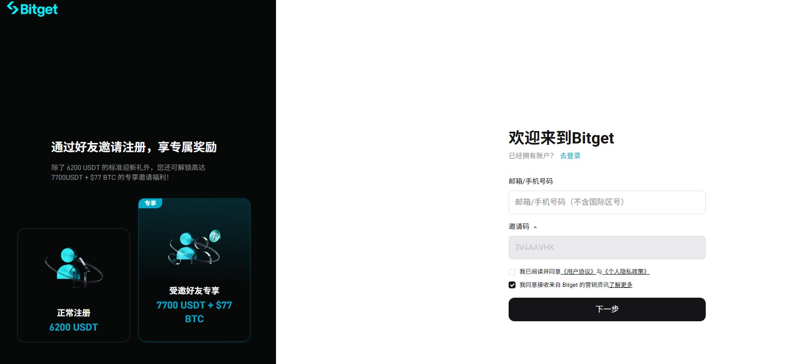

# 白嫖 Bitget 20% 手续费！邀请码 3V4AAVHK 一填，合约直接打 8 折

玩合约的朋友应该都有感觉：手续费看着单笔不多，积少成多真的很伤。我自己在 Bitget 交易了一段时间后才发现，原来注册时填对一个邀请码，每笔手续费都能直接打八折。不过这事没那么简单，我身边就有人兴冲冲填了码，结果账单里压根没见返佣。所以今天想把我摸清楚的门道完整讲一遍，帮你少走弯路。

## 返佣 20% 到底是什么概念

直接讲重点。现在通过邀请码 `3V4AAVHK` 注册 Bitget，能拿到 20% 的手续费减免，这笔钱由 Bitget 系统自动处理，不需要你额外申请，也没有时间限制。换算下来，合约的吃单费率从 0.06% 降到 0.048%，现货则是从 0.1% 降到 0.08%。

我一开始也疑惑，20% 是按交易金额算还是按手续费算？查了官方说明才搞明白，基数是手续费本身。比如这个月总共交了 50 USDT 手续费，那就能返还 10 USDT。交易越频繁、金额越大，省下的绝对值就越可观。

## 注册环节最容易翻车的细节

我发现大部分人拿不到返佣，问题都出在注册这一步。总结下来有几个关键点。

邀请码框一定要确认填进去了。有些推广链接点进去后代码不会自动带入，页面干干净净什么都没有，这时候就得手动输入 `3V4AAVHK`。填完之后别急着下一步，退回去再检查一遍有没有被清掉。

还要留意页面上有没有明确写出优惠内容。正规的官方活动通常会直接展示返佣比例，如果什么提示都没有，就要多留个心眼。

Bitget 还有个特殊之处：输入邀请码后页面不会跳出"你将获得 XX% 返佣"之类的提示，所以光靠注册页其实看不出端倪。想确认的话，得去后台看这组码的推广设置，里面"直客"对应的数字才是你真正能拿到的比例。

另外提醒一句，Bitget 从 2023 年开始就强制新用户注册时做身份认证了，身份证件提前放在手边，别等到验证环节再翻箱倒柜。

## 拿到账号后第一件事该干什么

很多人注册完就直接冲进去开单了，其实先花两分钟确认返佣状态更稳妥。登录后进到账户相关页面，看看推荐关系有没有挂上、比例显示多少。万一显示为空或者数字不对，赶紧回头查注册时的邀请码是不是没填对。要是确认填码没问题还是没生效，那只能走官方客服渠道了，一切以官方口径为准。

## 算一笔账：返佣到底能省多少

Bitget 的基础费率结构是这样的：合约挂单 0.02%、吃单 0.06%，现货买卖双向都是 0.1%。拿 20% 返佣套进去算，实际成本就是合约吃单 0.048%、现货 0.08%。

举几个直观的例子。假设你做合约，一个月累计成交 50 万 USDT，按吃单费率 0.06% 算，手续费要交 300 USDT。有了 20% 返佣，能拿回 60 USDT，等于实际只花了 240 USDT。要是现货党，月成交 20 万 USDT，原本报 200 USDT 手续费，返佣后只需承担 160 USDT。

这还只是按标准费率算的，如果你本身已经是 VIP、享受更低费率，返佣基数会相应缩水，但该返的部分一分不少。

## 有几种情况是拿不到返佣的

官方政策里明确列了几类排除情形，最好提前知道。手续费本身为零的交易不会产生返佣，很好理解。使用特殊费率通道的交易也算在内。还有一种是返佣卡，这种情况下返还的不是现金而是卡片形式，使用规则又不一样。

另外要划重点：同一个 IP 或同一台设备下的推荐行为会被系统判定为自我推荐，不会被计入。已经注册过的老账号再去填邀请码同样无效。所以填码机会只有注册那一刻，务必珍惜。

## 老用户常见的三个疑问

**账号早就注册了，现在补填行不行？** 不行。官方没有开放补填入口，已注册用户也不会被识别为新受邀人。理论上可以注销后重开，但有 30 天冷静期之类的限制，为了这点返佣去冒账号风险，我觉得不划算。

**返佣会过期吗？** 推荐关系一经建立就永久有效，只要你还在 Bitget 交易，返佣就一直跟着你。唯一变量是比例本身，官方如果调整政策，会以最新公告为准。

**已经有 VIP 费率了，返佣还算不算？** 算的。VIP 优惠和邀请码返佣并不冲突，只是计算时以扣完 VIP 折扣后的净手续费为基数。费率本来就低，返佣绝对额自然也少一些，这是正常的。

**用 BGB 代币抵扣手续费呢？** 这个官方没有给出明确的叠加规则。按"净手续费 × 比例"的逻辑推断，抵扣后手续费基数变小，返佣金额大概率也会跟着降。保险起见，交易一两个月后去账单里核对实际到账情况。

## 这些地区用不了 Bitget

注册之前务必确认自己所在地区是否在限制名单内。根据官方服务条款，美国（含属地）、加拿大、日本、香港、新加坡、马来西亚、泰国、法国、德国、奥地利、哈萨克斯坦、伊朗、伊拉克、朝鲜、古巴、苏丹等地均被排除，乌克兰的克里米亚、顿涅茨克、卢甘斯克地区也在列。条款更新较频繁，注册前最好再查一遍最新版本，别卡在实名认证那一步进退两难。

## 我的体验总结

客观讲，20% 在众多交易所里不算拔尖——XT 和 WEEX 的合约返佣能到 60%，差距不小。但 Bitget 的优势在于流程省心：官方自动到账，不用催不用问，规则也相对透明。如果你本来就打算用 Bitget，那这个码没理由不用。

操作上就两步：注册时盯着邀请码框确认填好 `3V4AAVHK`，注册完马上去账户核实返佣生效。做完这两件事，后面躺着等返还就行。

最后还是那句老话，加密市场风险高，以上纯属个人经验，不构成投资建议。各地监管政策差异大，行动前先了解清楚当地的法规要求。费率和返佣比例随时可能调整，一切以交易所实时页面为准。
